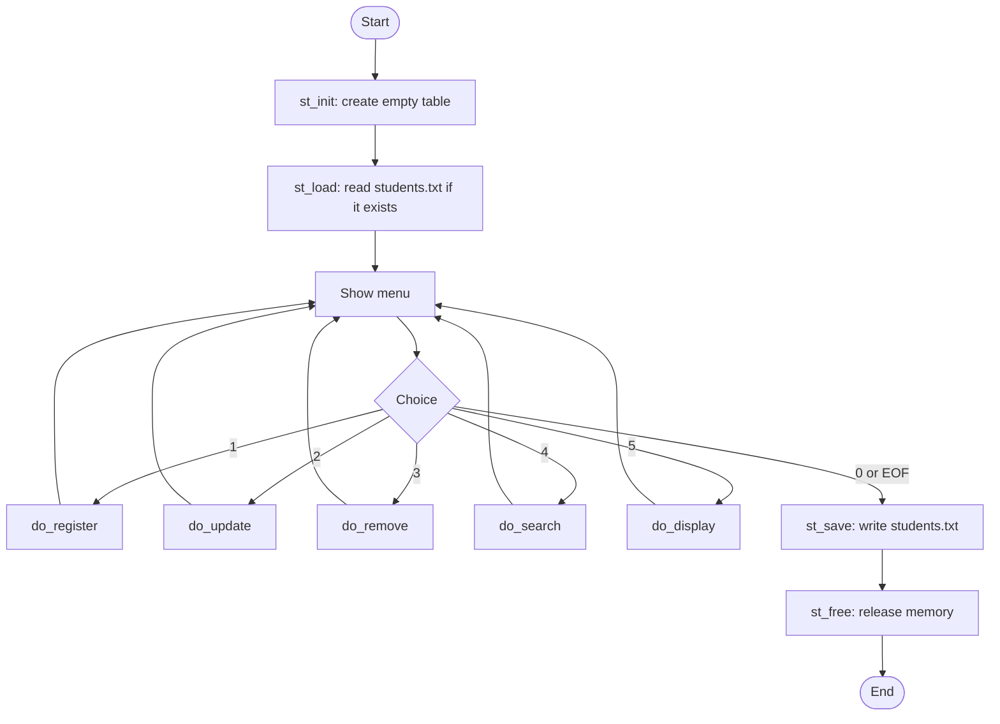

# CampusAssist – Part 1: Student Information Management

This document explains the complete code flow of the student management module. The C files contain code only; every explanation lives here.

---

## 1. Project files

| File | Role |
|---|---|
| `student.h` | Public interface: constants, data types, and function declarations. Other modules (library, complaints) include this. |
| `student.c` | The data layer: hash table, sorting, display, and file save/load. No user interaction except printing records. |
| `main.c` | The user interface: menu loop, input reading, validation. Calls the functions in `student.c`. |
| `Makefile` | Build instructions. |
| `students.txt` | Created at runtime. Holds saved records between runs. |

### Build and run

```
make
./campusassist
```

Without make:

```
gcc -Wall -Wextra -std=c99 -O2 -o campusassist main.c student.c
./campusassist
```

---

## 2. Design choices

### 2.1 Why a hash table with separate chaining

The problem statement asks for search by unique student ID that stays practical as the number of records grows.

| Option | Lookup | Insert | Remove | Notes |
|---|---|---|---|---|
| Unsorted array | O(n) | O(1) | O(n) | Too slow when n grows |
| Sorted array | O(log n) | O(n) | O(n) | Shifting elements is costly |
| Balanced BST (AVL) | O(log n) | O(log n) | O(log n) | Good, but complex to code |
| **Hash table (chaining)** | **O(1) avg** | **O(1) avg** | **O(1) avg** | Simple, fastest for key lookup |

A hash table is chosen because the main query is "find student by ID", an exact-match lookup. A hash table does this in constant average time.

### 2.2 Collision handling: separate chaining

Each bucket holds a singly linked list of students whose IDs hash to that bucket. A new student is inserted at the head of the chain in O(1).

### 2.3 Dynamic resizing

If the table never grew, chains would get longer and lookups would drift toward O(n). So when the load factor `count / capacity` would exceed `0.75`, the bucket array is doubled and every node is relinked into the new array (rehashing). One resize costs O(n), but since the capacity doubles each time, the cost averages to O(1) per insertion (amortised).

### 2.4 Why sorting is separate

A hash table has no ordering. To display students by name, department, or CGPA, the program builds a temporary array of pointers to all students and sorts it with **merge sort**.

- O(n log n) in best, average, and worst cases.
- Stable (equal elements keep their relative order).
- Only pointers are moved, so student records are never copied.

---

## 3. Data types (`student.h`)

### `Student`

```c
typedef struct Student {
    int   id;
    char  name[NAME_LEN];     /* 50 */
    char  dept[DEPT_LEN];     /* 30 */
    float cgpa;               /* 0.0 - 10.0 */
    int   semester;           /* 1 - 8 */
    struct Student *next;     /* next node in the same bucket */
} Student;
```

One node of a chain. `id` is the unique key. `next` links students that landed in the same bucket.

### `StudentTable`

```c
typedef struct {
    Student **buckets;   /* array of chain heads */
    int capacity;        /* number of buckets */
    int count;           /* students stored */
} StudentTable;
```

### `SortKey`

Selects the display order: `SORT_BY_NAME`, `SORT_BY_DEPT`, `SORT_BY_CGPA`.

### `StStatus`

Return codes: `ST_OK`, `ST_DUPLICATE_ID`, `ST_NOT_FOUND`, `ST_NO_MEMORY`, `ST_FILE_ERROR`. They let `main.c` decide what message to show without the data layer doing any user interaction.

---

## 4. Overall program flow



Step by step:

1. `main` creates an empty table with `st_init`.
2. `st_load` reads `students.txt` (if present) and registers each saved student.
3. The menu loop shows options and reads a choice with `read_int`, which only accepts a number from 0 to 5.
4. The matching `do_*` function runs, then the menu appears again.
5. Choosing `0` (or reaching end of input) leaves the loop. `main` saves with `st_save`, frees memory with `st_free`, and exits.

---

## 5. `main.c` – the user interface

### 5.1 Input helpers

| Function | What it does |
|---|---|
| `read_line(prompt, buf, size)` | Prints the prompt, reads a line with `fgets`, removes the trailing newline, and replaces any `\|` with a space (because `\|` is the file delimiter). Returns 0 on end of input. |
| `read_int(prompt, lo, hi)` | Repeats until the user enters a whole number in `[lo, hi]`. Uses `strtol` and checks that the entire input was consumed. Returns -1 on end of input. |
| `read_float(prompt, lo, hi)` | Same idea for decimals using `strtof`. |
| `read_required(prompt, buf, size)` | Repeats until a non-empty string is entered. |

`fgets` + `strtol` is used instead of `scanf` to avoid buffer overflows and the leftover-newline problems that `scanf` causes.

### 5.2 Menu actions

**`do_register`**
1. Read the ID (1 to 2,000,000,000).
2. Call `st_find`. If the ID exists, stop early with a message so the user does not retype everything.
3. Read name, department, CGPA (0–10), and semester (1–8).
4. Call `st_register` and print success or failure.

**`do_update`**
1. Read the ID and look it up. If missing, print a message and return.
2. Show the current record.
3. Copy the current values into local variables. Ask for each new value; pressing Enter keeps the old one. Invalid CGPA or semester input keeps the old value.
4. Call `st_update` with the final values. Working on copies means a half-finished edit never corrupts the stored record.
5. The ID itself cannot be changed because it is the hash key.

**`do_remove`**: read the ID, call `st_remove`, print whether a student was removed.

**`do_search`**: read the ID, call `st_find`, print the record or a not-found message.

**`do_display`**: ask for 1 (name), 2 (department), or 3 (CGPA), convert to a `SortKey`, and call `st_print_all`.

---

## 6. `student.c` – the data layer

### 6.1 `hash_id(id, capacity)`

```c
return ((unsigned int)id * 2654435761u) % (unsigned int)capacity;
```

A multiplicative hash. `2654435761` is a large odd constant (Knuth's golden-ratio constant). Multiplying scatters sequential IDs like 1001, 1002, 1003 across the buckets instead of clustering them. The result is reduced into `[0, capacity)` with `%`.

### 6.2 `st_init` and `st_free`

- `st_init` sets capacity to 16, count to 0, and allocates the bucket array with `calloc` so every chain head starts as `NULL`.
- `st_free` walks every bucket, frees every node (saving `next` before each `free`), then frees the bucket array.

### 6.3 `st_find(t, id)`

1. Compute the bucket with `hash_id`.
2. Walk that chain comparing `id`.
3. Return the matching node, or `NULL`.

Average O(1) because chains are short. This is the function other modules should call to confirm that a student is registered.

### 6.4 `st_register`

1. If `st_find` finds the ID, return `ST_DUPLICATE_ID`.
2. If adding one more student would push the load factor above 0.75, call `st_resize`.
3. Allocate a new node. Copy name and department with `strncpy` and force a `'\0'` at the end, so the fixed arrays can never overflow.
4. Hash the ID, link the node in at the head of that bucket's chain, and increment `count`.

### 6.5 `st_resize`

1. Allocate a bucket array of double the size.
2. For each old bucket, take every node, compute its bucket in the new array, and push it onto that chain. Nodes are relinked, not copied.
3. Free the old array and update `capacity`.

If allocation fails, the old table is kept, so the program continues working (just a bit slower).

### 6.6 `st_update`

Finds the student with `st_find` and overwrites name, department, CGPA, and semester. Returns `ST_NOT_FOUND` if the ID does not exist.

### 6.7 `st_remove`

1. Hash the ID and walk the chain with two pointers, `prev` and `cur`.
2. When `cur->id` matches: if `prev` exists, set `prev->next = cur->next`; otherwise the node was the chain head, so set the bucket to `cur->next`.
3. Free the node and decrement `count`.

### 6.8 Sorting

**Comparators** (return negative, zero, or positive, like `strcmp`):

| Function | Order |
|---|---|
| `cmp_name` | Name A→Z; ties broken by ID |
| `cmp_dept` | Department A→Z, then name, then ID |
| `cmp_cgpa` | CGPA highest first; ties by name |

**`merge_sort(arr, tmp, lo, hi, cmp)`** splits the range in half, sorts each half recursively, and calls `merge`. The comparator is passed as a function pointer, so one sort routine serves all three orders.

**`merge`** combines two sorted halves into `tmp`, then copies back into `arr`. It takes from the left half on ties, which keeps the sort stable.

### 6.9 Display

**`st_print_one`** prints one student as a table row.

**`st_print_all(t, key)`**
1. If the table is empty, print a message and return.
2. Allocate two pointer arrays (`arr` and `tmp`) of size `count`.
3. Walk every bucket and chain, storing each node's address in `arr`.
4. Pick the comparator from `key` and run `merge_sort`.
5. Print a header, every row in order, and the total.
6. Free both arrays. The hash table itself is untouched.

### 6.10 Persistence

**File format** (`students.txt`), one student per line, fields separated by `|`:

```
1001|Asha Rao|CSE|8.50|2
1002|Bala K|ECE|9.10|2
```

**`st_save`** opens the file for writing and prints every student using `fprintf`. Chain order does not matter.

**`st_load`** reads each line with `fgets` and parses it with:

```c
sscanf(line, "%d|%49[^|]|%29[^|]|%f|%d", ...)
```

`%[^|]` reads text up to the next `|`, which allows spaces in names. A line is registered only if all 5 fields were parsed, so malformed lines are skipped. A missing file returns `ST_FILE_ERROR`, which `main` treats as "first run" and ignores.

---

## 7. Example session

```
===== CampusAssist: Student Management =====
Choice: 1
Student ID (positive number): 1001
Name: Asha Rao
Department (e.g. CSE): CSE
CGPA (0.0 - 10.0): 8.5
Semester (1-8): 2
Student registered.

Choice: 5
Choice: 3          <- display by CGPA
ID       Name                     Department         CGPA   Sem
---------------------------------------------------------------
1002     Bala K                   ECE                 9.10   2
1001     Asha Rao                 CSE                 8.50   2
Total: 2 student(s)
```

---

## 8. Complexity analysis

Let `n` be the number of students and `m` the number of buckets.

| Operation | Time (average) | Time (worst) | Extra space |
|---|---|---|---|
| `st_find` | O(1) | O(n) | O(1) |
| `st_register` | O(1) amortised | O(n) on a resize | O(1) per student |
| `st_update` | O(1) | O(n) | O(1) |
| `st_remove` | O(1) | O(n) | O(1) |
| `st_resize` | O(n + m) | O(n + m) | O(m) for the new array |
| `st_print_all` | O(n log n) | O(n log n) | O(n) for `arr` and `tmp` |
| `st_save` / `st_load` | O(n + m) / O(n) average | – | O(1) |

**Space overall:** O(n + m). Since `m` stays proportional to `n` (load factor between about 0.375 and 0.75), this is O(n).

The worst case O(n) for lookup happens only if every ID lands in the same bucket, which the multiplicative hash and resizing make very unlikely.

---

## 9. Testing notes

Tested behaviours:

- Registering, updating, removing, and searching students.
- Duplicate ID rejected on registration.
- Invalid input (letters, out-of-range numbers, empty fields) is rejected and re-prompted.
- All three sort orders, including ties.
- Records persist after exit and reload on the next run.
- A stress test with 200,000 records: all lookups succeeded, 100,000 removals worked, and AddressSanitizer reported no memory errors.

For the comparative performance study required in the final report, time `st_find` for different values of `n` (for example 1,000; 10,000; 100,000) and compare against a linear scan. Also time `st_print_all` sorting at the same sizes to show the O(n log n) growth.

---

## 10. Integrating with other modules

- **Library module:** call `st_find(&table, student_id)` before issuing or reserving a book. If it returns `NULL`, reject the request.
- **Complaint module:** store the student's ID in each complaint and validate it with `st_find` when the complaint is submitted.
- **Shared table:** create one `StudentTable` in the integrated `main` and pass a pointer to every module.
